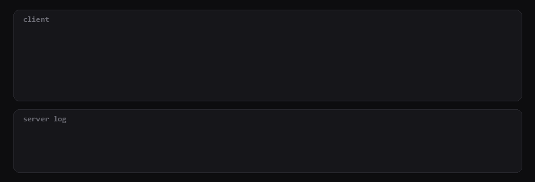
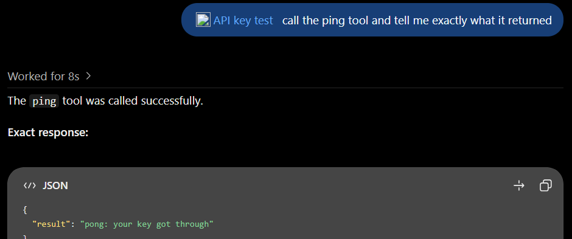

# mcp-api-key-server

A tiny MCP server that only answers requests carrying an API key. Use it to check whether an MCP client, proxy, or tunnel really sends the key you configured.

A lot of self-hosted MCP servers are protected by a static API key in a header, while some MCP clients only offer OAuth or no auth. This server makes it easy to see what actually arrives.



## What it does

- Listens on `http://localhost:8765/mcp`, stateless Streamable HTTP.
- Every request needs the key as `X-API-Key: <key>` or `Authorization: Bearer <key>`. Without it you get a `401` and nothing runs.
- With the key, it exposes one tool, `ping`, which returns `pong: your key got through`.
- It prints one line per request showing how the key arrived and whether it was let in:

```
[20:14:07] POST /mcp  key via: none                   -> REJECTED
[20:14:07] POST /mcp  key via: X-API-Key              -> ALLOWED
```

## Run it

```bash
pip install -r requirements.txt
MCP_API_KEY=pick-a-key python server.py
```

On Windows PowerShell:

```powershell
$env:MCP_API_KEY = "pick-a-key"; python server.py
```

`MCP_PORT` changes the port.

## Quick check with curl

```bash
# no key -> 401
curl -s -H "Content-Type: application/json" -H "Accept: application/json, text/event-stream" \
  -d '{"jsonrpc":"2.0","id":1,"method":"tools/call","params":{"name":"ping","arguments":{}}}' \
  http://localhost:8765/mcp

# with key -> "pong: your key got through"
curl -s -H "Content-Type: application/json" -H "Accept: application/json, text/event-stream" \
  -H "X-API-Key: pick-a-key" \
  -d '{"jsonrpc":"2.0","id":1,"method":"tools/call","params":{"name":"ping","arguments":{}}}' \
  http://localhost:8765/mcp
```

## Example: ChatGPT through OpenAI's Secure MCP Tunnel

ChatGPT's "Add custom MCP server" dialog only offers OAuth or no auth, so it can't send an API key itself. OpenAI's [tunnel-client](https://github.com/openai/tunnel-client) can add one on the way through.

1. Create a tunnel in [Platform tunnel settings](https://platform.openai.com/settings/organization/tunnels) and set up tunnel-client with the `sample_mcp_remote_no_auth` profile, pointing it at `http://127.0.0.1:8765/mcp`.
2. Give tunnel-client the key with its static header setting: `MCP_EXTRA_HEADERS="X-API-Key: env:MCP_API_KEY"` (see its [configuration docs](https://github.com/openai/tunnel-client/blob/main/docs/configuration.md)).
3. In ChatGPT, add a custom MCP server with connection **Tunnel** and **No authentication**, then ask it to call `ping`.

If the server log shows `key via: X-API-Key -> ALLOWED` and ChatGPT gets the pong back, the key made it through.

**Result: works.** Tested on Nov 10, 2026 with tunnel-client v0.0.20. ChatGPT listed the tunnel, connected with No authentication, and every request it made reached the server with `X-API-Key` and was allowed:

```
[20:44:25] POST /mcp  key via: X-API-Key              -> ALLOWED
[20:44:26] POST /mcp  key via: X-API-Key              -> ALLOWED
```



Two Windows notes from setting it up: run `tunnel-client init` from the same shell you'll run it from (Git Bash and PowerShell use different default profile folders), or set `TUNNEL_CLIENT_PROFILE_DIR`. The profile's `api_key` can be `file:C:/path/to/key` so the OpenAI key never sits in your shell history.
